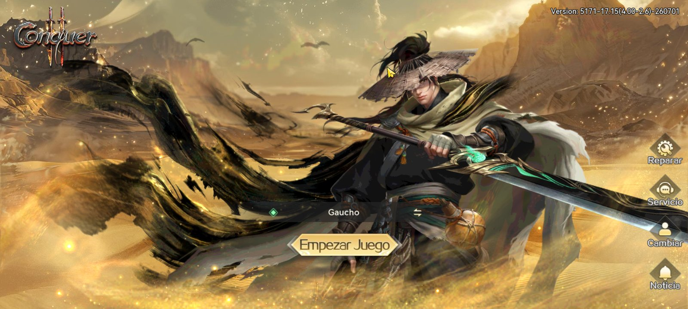
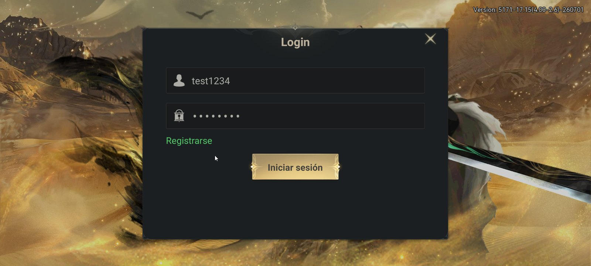
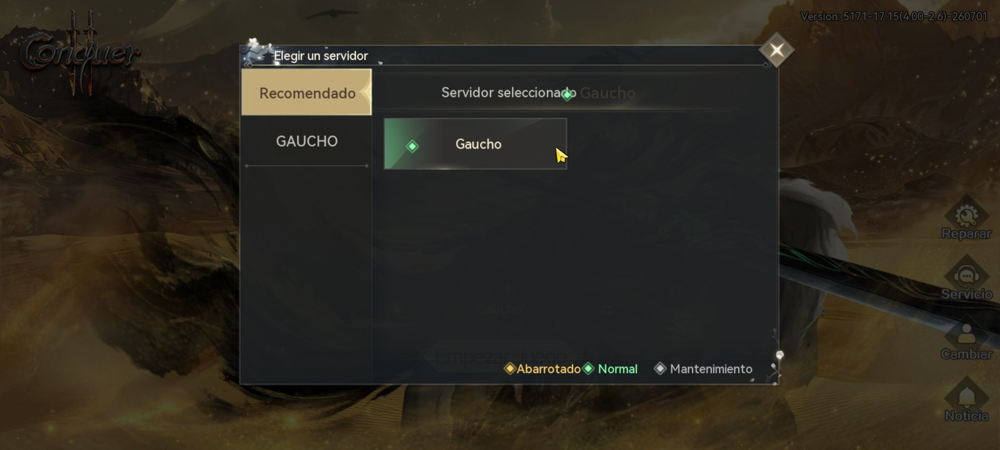
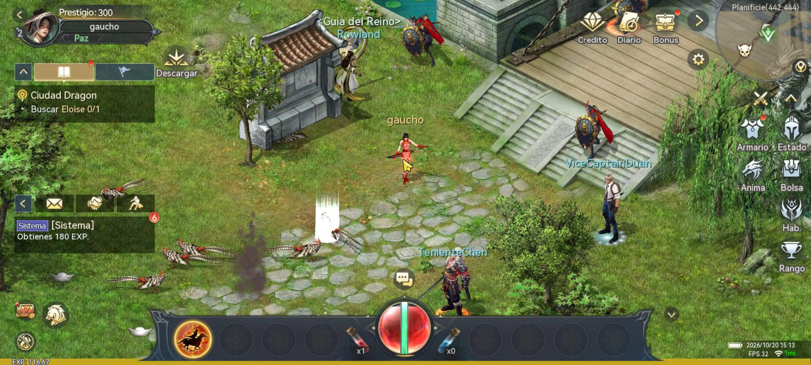

<!-- ;trollface; Ymlvd2VhcG9uCg==, bioweapon-->
<!-- ······················
 · with love from bolzov (●'◡'●)
 · https://github.com/ibolzov
 · gaucho - conquer mobile private server
 ······················ -->

# gaucho

conquer online mobile server (client 1.1.2.3) in rust. skeleton: auth + game server in one binary.
update of my march/april version.

<p align="center">
  
  
  
  
</p>

## run

```
run_server.bat [ip]
```

ports 8020 auth, 5816 game, 9528 login. env: `CQ2_BIND_HOST`, `CQ2_DATA`, `CQ2_TRACE=1`, `CQ2_GM`.

## apk

drag the apk onto `scripts\set_ip.bat`. building it from a new client: [docs/APK.md](docs/APK.md).

## works

accounts ([docs/ACCOUNTS.md](docs/ACCOUNTS.md)), 11 classes, 50 maps, npcs, monsters, guards, portals, pve/pvp,
friends, trade, chat, main quest chain, items, skills, mounts, titles, guilds, mail.

todo: parties, no-pk maps, npc dialogs outside quests, instances.

## commands

gm: `/level` `/tp` `/quest` `/title` `/ride` `/guild` `/money` `/item` `/heal` `/new` `/who`. everyone: `/characters` `/switch`.
